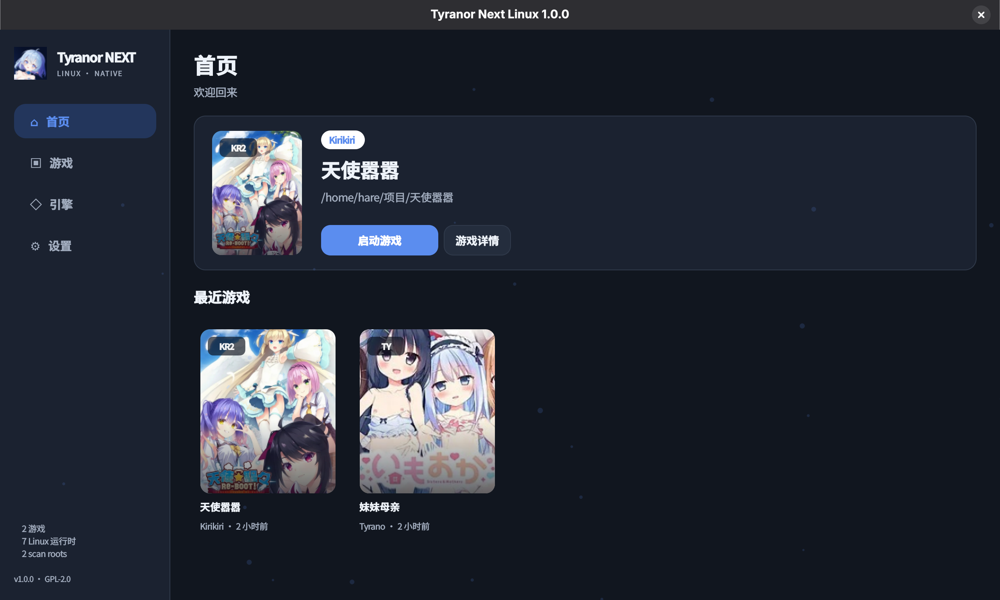

# Tyranor Next Linux


Tyranor Next 的原生 Linux 桌面版本。项目使用 Python、PyQt6 和 SQLite，
通过 Linux 子进程直接启动游戏，不依赖 Android、Waydroid、Activity、JNI
或 APK 运行时。

## 主要功能

- 原生游戏库：目录扫描、深度控制、增量更新、搜索、排序、网格和列表视图。
- 引擎识别：KiriKiri、Tyrano、Ren'Py、RPG Maker MV/MZ、RPG Maker
  XP/VX/VX Ace、ONScripter、Artemis、Siglus、RealLive、AVG32、UK2、
  System35、System4、FVP、Ethornell、VN 和网页游戏。
- 启动管理：逐游戏参数、环境变量、启动前缀、运行状态保护和游玩时长记录。
- KiriKiri：使用原生 `krkrsdl3`，支持 XP3、Wayland、ALSA 和中央存档目录。
- Tyrano 与网页游戏：支持 3 GB 级 Electron ASAR 流式读取、HTTP Range、
  内嵌 Qt WebEngine、持久化浏览器存储和文件存档。
- Ren'Py：可调用系统运行时，也可使用随 RPM 安装的 Ren'Py 8.5.3。
- 存档管理：统一存档目录、旧存档迁移、ZIP 导入导出、内容版本、SHA-256
  校验、恢复和运行中写保护。
- RPG Maker 存档：MV/MZ 标准存档格式双向转换。
- 封面来源：本地图片、VNDB、NextMoe、Bangumi、Steam 和 Hikarinagi。
- WebDAV：双向、上传、下载、整库同步、内容版本和云端保留数量。
- 维护工具：XP3 查看、解包、重新封包、同名冲突保护、KSD 文本解码和补丁。
- 界面：首页、游戏库、引擎、设置、快捷启动、桌面快捷方式、主题和多语言。




## 安装

### 添加 Hare RPM 仓库

```bash
sudo curl --fail --location --output /etc/yum.repos.d/hare-rpm-repo.repo https://raw.githubusercontent.com/Yohane-Mashiro/hare-rpm-repo/gh-pages/hare-rpm-repo.repo
sudo dnf clean all
sudo dnf makecache
```

### 软件包说明

| 软件包 | 用途 | 架构 | 兼容性 |
| --- | --- | --- | --- |
| `tyranor-next-linux` | 主程序，提供游戏库、引擎识别、封面、存档管理、WebDAV、XP3 工具和启动界面 | `noarch` | Fedora 45；依赖 PyQt6 WebEngine、KiriKiri 和 Ren'Py 运行时 |
| `tyranor-next-krkr-runtime` | 原生 KiriKiri 运行时 `krkrsdl3`，用于启动 `.xp3` 游戏 | `x86_64` | Fedora 45 x86_64；支持 Wayland、ALSA、XP3 和中央存档目录 |
| `tyranor-next-renpy-runtime` | Ren'Py 8.5.3 Linux 运行时，用于 Ren'Py 游戏 | `x86_64` | Fedora 45 x86_64；游戏自带启动器可执行时优先使用自带版本 |

## 许可证

本项目使用 GPL-2.0-only。第三方运行时分别遵循其上游许可证。
